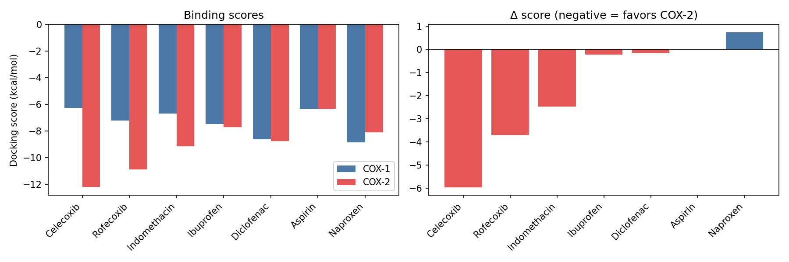

# Remedy Structure Explorer

Visualizing, docking, and simulating common remedies and their protein targets, all in Google Colab. The project starts with a simple molecule (aspirin) and builds up to how it binds to its target enzyme, COX-1, and how drugs differ between COX-1 and COX-2.

## Notebooks

Click a badge to open the notebook in Colab.

| Notebook | What it does | Open |
|---|---|---|
| aspirin_structure | 2D and 3D structure of aspirin, properties, functional groups |  |
| insulin_folding | Insulin protein structure, helices, disulfide bonds, AlphaFold comparison |  |
| aspirin_cox1_docking | Docking aspirin into COX-1 with AutoDock Vina, validated by re-docking |  |
| aspirin_cox1_md | Molecular dynamics of the aspirin-COX-1 complex in water (OpenMM, GPU) |  |
| cox_selectivity_docking | Seven remedies docked into COX-1 and COX-2, compared to known selectivity |  |

## Why aspirin's structure matters

| Part | Role |
|---|---|
| Benzene ring | Rigid, flat backbone |
| Carboxylic acid | Acidity, solubility, binding |
| Ester (acetyl group) | Acetyl group is transferred to Ser530 in COX, blocking the channel (this covalent step is not modeled here) | 

## Results

> COX-1 re-docking currently fails validation (6.11 Å), so COX-1 scores
> and Δ values below are **provisional**.

- -Docking validation:* COX-2 celecoxib re-dock RMSD = 0.56 Å (pass); COX-1 ibuprofen re-dock RMSD = 6.11 Å (fail, threshold 2 Å). Aspirin notebook ibuprofen re-dock RMSD = 6.15 Å
- *Aspirin docking score:* -6.41 kcal/mol; residues within 4 Å (heavy atoms): TYR348, VAL349, LEU352, LEU384, TYR385, TRP387, PHE518, MET522, ILE523, GLY526, SER530
- *MD:* mean aspirin RMSD = [TODO] Å over [TODO] ns
- **Selectivity:** Δ = COX-2 score minus COX-1 score (more negative favours
  COX-2). Mean Δ for COX-2-selective drugs = **-4.83 kcal/mol**; for the
  other five drugs = **-0.42 kcal/mol**.

| Drug | COX-1 | COX-2 | Δ | Literature class* |
|---|---|---|---|---|
| Celecoxib | -6.25 | -12.21 | -5.96 | COX-2 selective |
| Rofecoxib | -7.20 | -10.89 | -3.69 | COX-2 selective |
| Indomethacin | -6.68 | -9.14 | -2.46 | COX-1 preferring |
| Ibuprofen | -7.49 | -7.71 | -0.22 | non-selective |
| Diclofenac | -8.61 | -8.76 | -0.15 | slightly COX-2 preferring |
| Aspirin | -6.34 | -6.33 | +0.01 | COX-1 preferring |
| Naproxen | -8.84 | -8.10 | +0.74 | non-selective |

*Approximate classes from the literature, not measured values. kcal/mol,
AutoDock Vina, single seed (42).

- **Insulin (4INS vs AlphaFold P01308):** -Cα RMSD = 7.11 Å. AlphaFold
  confidence over the insulin chains is mostly low (pLDDT roughly 40-56).

## What I learned

- Docking ranked the two coxibs as most COX-2 selective, as expected, but
  my COX-1 validation failed, so the COX-1 side of every comparison is
  unreliable until that is fixed.
- It missed the other classes: aspirin and naproxen showed no clear
  preference, and indomethacin (COX-1 preferring) scored as COX-2 favouring.
- Vina scores tend to track molecule size, so some differences may reflect
  size and not selectivity. Next steps: repeat over several seeds, add
  size-normalised scores, fix the COX-1 box, and run longer MD with
  replicates.
- Insulin: AlphaFold is low-confidence on the isolated A and B chains,
  consistent with insulin folding as proinsulin. [note that the 7.11 Å global Cα RMSD across chains A and B reflects flexible termini and the absence of the C-peptide tether in the single-chain preproinsulin prediction, even though the helical core aligns closely].

## How to run

1. Click a badge above.
2. In Colab choose **Runtime, Run all**.
3. The MD notebook needs a GPU: Runtime, Change runtime type, T4 GPU.

## Tools

Python, RDKit, py3Dmol, AutoDock Vina, OpenMM, MDTraj. Structures from the
RCSB Protein Data Bank: 1EQG (COX-1), 3LN1 (COX-2), 4INS (insulin).

## Limitations

Docking and short MD runs are approximate. Rigid receptors, no heme or water in docking, and aspirin's covalent binding is not modeled. Results show plausible binding, not proof.

## License

MIT
